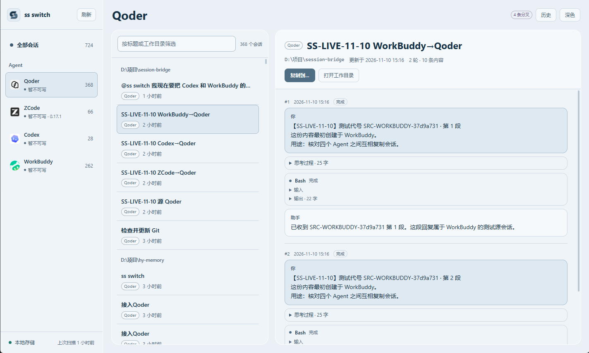
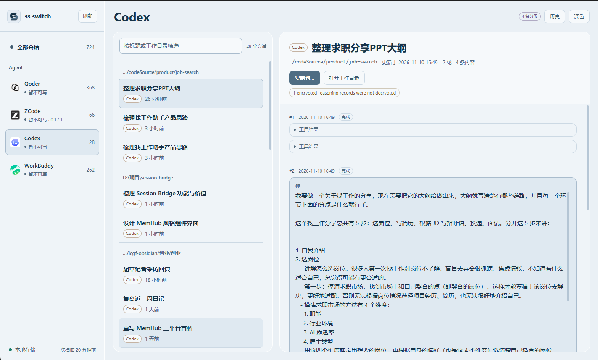
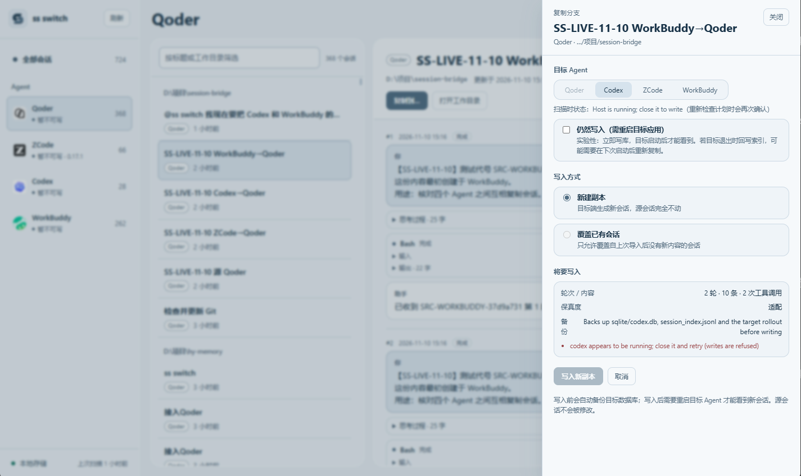
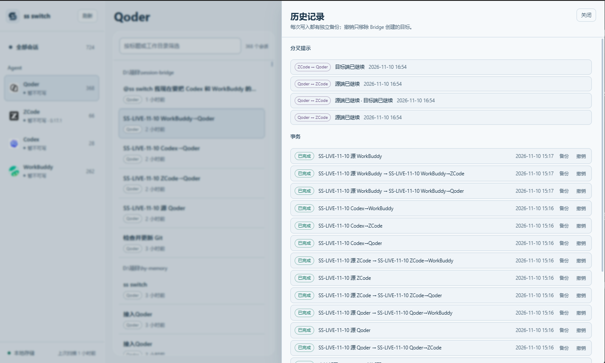
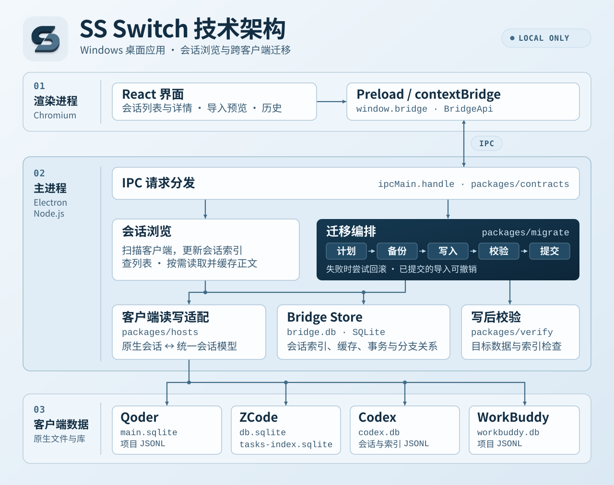

<p align="center">
  
</p>

# ss switch (Session Switch)

> 跨平台 AI 编程会话（上下文）无缝迁移工具。打破工具壁垒，带着记忆在不同的 Harness 之间自由横跳。

---

##  为什么需要 ss switch？

作为重度 AI 开发者，你一定遇到过这样的崩溃时刻：
在工具 A 里辛辛苦苦调教了半天，把项目背景、架构方案和 Bug 细节全部“喂”给模型，正准备冲刺完成时——**Rate Limit** 弹出来了，额度用尽。

如果想换到另一个有额度的工具 B 继续，就必须把长篇大论重新复制粘贴一遍，不仅极其痛苦，还经常丢失上下文心流。

**ss switch** 应运而生。它将你的对话记忆与具体的 AI 编程客户端（Harness）解耦，让你实现零冷启动、无缝续聊。


##  核心功能

- **一键迁移：** 在当前工具点击复制，选择目标 Harness，点击开始即可完成上下文注入。
- **零冷启动：** 新 Harness 完美继承之前的记忆，无需重新输入背景信息，直接接着上一句继续干活。
- **多平台支持：** 目前已支持主流 AI 编程客户端，更多平台持续接入中。

### 当前支持的 Harness
- Qoder
- ZDox
- ZCode
- Codex
- WorkBuddy
- *(Claude Code 等正在持续接入中)*

---

<table align="center" aria-label="SS Switch 产品界面">
  <tr>
    <td></td>
    <td></td>
  </tr>
  <tr>
    <td></td>
    <td></td>
  </tr>
</table>

##  核心价值与使用场景

### 1. 突破额度限制，告别中断
当某个客户端的额度耗尽时，无需等待冷却，也无需被迫额外充值。直接用 `ss switch` 切换到另一个有额度的工具，保证开发心流不中断。

### 2. 极致“薅羊毛”
各大 AI 编程客户端/Harness 经常推出免费额度或促销活动。通过 `ss switch`，你可以把全网的免费额度串联起来利用，实现零成本白嫖高阶 AI 能力。

### 3. “架构师 + 包工头”的高低搭配工作流
* **顶层设计阶段：** 先在能力最强、最聪明的模型/Harness 里梳理架构、写技术方案、定好设计图。
* **批量实现阶段：** 用 `ss switch` 把带上下文的会话一键切到更便宜、量更大的模型/Harness 中，让它照着方案疯狂写代码、搬砖。
* 既保证了产品质量，又大幅降低了整体使用成本。

---

<details>
<summary>商业合作请加微信</summary>

<p></p>

</details>

## 技术架构




## 快速开始

要求：Windows、Node ≥ 24、pnpm 10。

```bash
pnpm install
pnpm build
pnpm start          # 以开发方式启动（读取真实本地数据）
```

打包好的程序：目录版 `release/win-unpacked/ss switch.exe`，免安装版 `release/ss-switch-0.1.0-x64.exe`。重新打包：

```bash
pnpm package:win
```

首次启动会扫描四个 Agent 的本地数据，缓存在 `%APPDATA%\ss switch\bridge.db`。之后点“刷新”重新扫描。

## 使用方式

1. 左侧选择 Agent（或“全部会话”），中间按工作目录分组的会话列表，右侧预览统一时间线。
2. 只需要关闭**目标**应用；源应用可以继续开着。
   - 目标 Agent 自动选另一个可写的 Agent，也可以手动切换；
   - 默认“新建副本”；
   - 需要导回并替换原会话时选“覆盖已有会话”，从列表中选择 Bridge 导入过的会话。
3. 确认前会显示轮次、内容条数、工具调用数、保真度、丢弃项、备份说明和阻断原因。
4. 写入成功后可以“复制打开命令”，到目标 CLI 里 `resume`；也可以在重启目标桌面应用后从列表打开。
5. “历史”里查看每次导入、备份目录、撤销和分叉提示。

写入 Qoder、ZCode、Codex 或 WorkBuddy 前，都要先完全退出对应的目标桌面应用。原因见“安全边界”。

如果目标暂时不能关闭，可以在确认页勾选“仍然写入（需重启目标应用）”：只对“新建副本”开放，立即写库并校验，重启目标后可见；覆盖模式不允许这样写。

## 数据位置

| 内容              | 路径                                                                                                 |
| ----------------- | ---------------------------------------------------------------------------------------------------- |
| Bridge 索引与缓存 | `%APPDATA%\ss switch\bridge.db`                                                                      |
| 导入备份          | `%APPDATA%\ss switch\backups\<tx>\`                                                                  |
| Qoder 会话        | `~/.qoder-cn/projects/<slug>/<session>.jsonl` + `%APPDATA%\com.qodercn.app.stable\main.sqlite`       |
| ZCode 会话        | `~/.zcode/cli/db/db.sqlite` + `~/.zcode/v2/tasks-index.sqlite`                                       |
| Codex 会话        | `~/.codex/sessions/**/rollout-*.jsonl` + `~/.codex/session_index.jsonl` + `~/.codex/sqlite/codex.db` |
| WorkBuddy 会话    | `~/.workbuddy/workbuddy.db` + `~/.workbuddy/projects/**/*.jsonl`                                     |

## 已验证

可重复执行：

```bash
pnpm test          # 解析器 / 存储 / 导入计划 / 路径规则（21 项）
pnpm test:e2e      # 复制 → 覆盖 → 撤销 → 分叉 → 版本拒绝 → 四端往返（50 项，全部在临时副本上）
pnpm m0            # 写入器往返 + Qoder CLI 可见性（临时副本）
pnpm doctor        # 只读检查四个 Agent 的根目录、版本、会话数、写入条件
pnpm repair:zcode  # 修复已有 ZCode 导入（先退出 ZCode；自动备份由写入前流程负责）
```

已确认：

- Qoder 写入后，`qoderclicn --config-dir <tmp> --list-sessions` 能在对应工作目录列出新会话。
- Qoder 与 ZCode 的写入、覆盖、删除都在独立副本上通过；写入后读回轮次、工具调用、搜索结果一致。
- Codex 与 WorkBuddy 的写入、覆盖、撤销都在复制出来的 `codex.db` / `workbuddy.db` 上通过；Codex 写入后 rollout、`session_index.jsonl`、`local_thread_catalog` 三处一致，WorkBuddy 写入后 `sessions` 行与项目 JSONL 一致。
- Qoder→Codex→WorkBuddy 以及 Codex→WorkBuddy 的跨端复制能读回完整轮次；Codex 覆盖后撤销能还原原 rollout。
- 真实 Qoder 会话导入 ZCode 副本后，源 JSONL 哈希保持不变。
- 覆盖后的撤销能还原备份；复制后的撤销只移除新目标。
- 目标端在导入后新增内容会被标记为分叉；未知的新版本 schema 会拒绝写入（fail-closed）。

**桌面列表仍需一次人工确认**：Qoder、ZCode、Codex、WorkBuddy 的写入校验都在临时副本上完成，真实桌面列表的可见性需要在目标应用完全退出后写一次、再启动确认。额外探测确认：Qoder 桌面**不会**实时导入新出现的 JSONL（写入后 20 秒内 `chat_sessions` 没有新行），所以写入 `main.sqlite` 是必需的，并且必须重启 Qoder 才能在列表里看到新会话。Codex 与 WorkBuddy 同样写入了桌面列表所依赖的库（Codex 的 `local_thread_catalog`、WorkBuddy 的 `sessions`），需要在重启后确认。写真实库前请先完全退出目标应用，然后运行：

```bash
pnpm probe prepare   # 写入两条一次性测试会话（先备份）
# 打开 Qoder 与 ZCode，确认出现“ss switch 可见性测试”
# 完全退出两个应用
pnpm probe cleanup   # 删除测试会话，源数据不变
```

`pnpm probe status` 可查看目标索引里是否已出现这两条会话。


## 目录结构

```
apps/bridge-desktop   Electron 主进程、preload、bootstrap、electron-builder 配置
apps/bridge-web       React 19 + Vite 界面
packages/contracts    共享类型与 IPC 通道
packages/bridge-store Bridge 自有 SQLite（索引/缓存/lineage/tx/divergence）
packages/hosts        Qoder/Codex/ZCode/WorkBuddy 读取器 + 四个写入器
packages/migrate      备份、导入计划、事务、撤销、分叉检测
packages/verify       写入后断言
scripts               m0 / e2e / doctor / probe / 打包辅助
```

## 开发命令

```bash
pnpm typecheck     # 所有包
pnpm lint          # Biome
pnpm build         # 主进程 + 渲染层
pnpm package:win       # Windows 目录版（release/win-unpacked）
pnpm package:portable  # 单文件免安装版（release/ss-switch-*.exe）
```

## 商业合作请加微信


